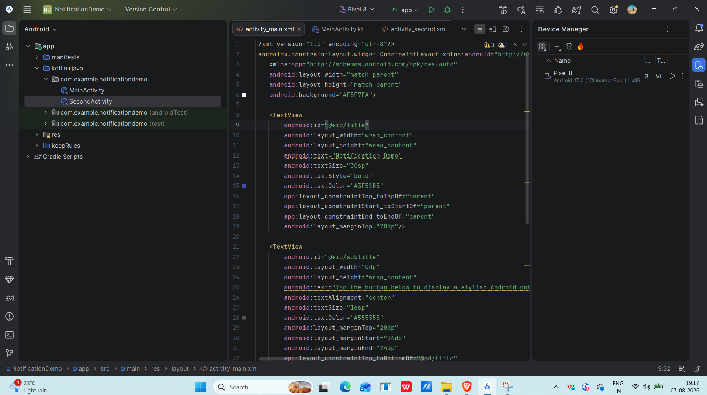
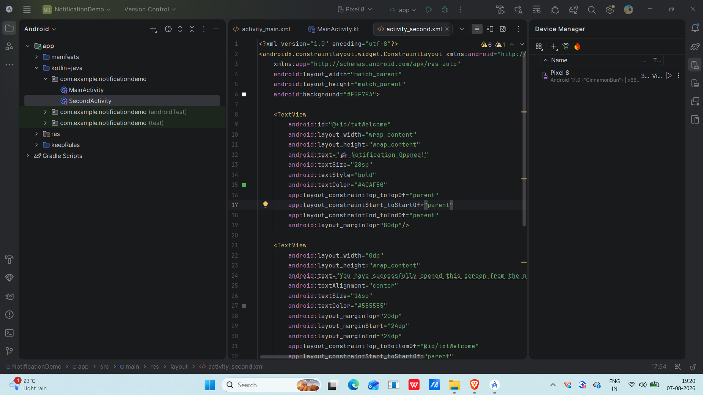

# Android Notification Demo

## Objective

To develop an Android application that demonstrates how to display notifications using Kotlin.

---

## Concept

Android Notifications are used to inform users about important events even when the application is not open. When the notification is tapped, it opens another activity in the application.

---

## Technology Used

- Kotlin
- Android Studio
- Android SDK
- NotificationManager
- NotificationCompat
- PendingIntent

---

## Scenario

The application contains a button named **Show Notification**. When the user clicks the button, a notification is displayed. Tapping the notification opens the second activity.

---

## Screenshots

### 1. Main Activity Design

---

### 2. Second Activity Design

---

### 3. Main Screen Output

---

### 4. Second Screen Output

---

## Name & USN Verification

Name: Suvendu Mata

USN: 25MCAR0136

## Conclusion

This experiment demonstrates how to create and display Android notifications using Kotlin and how a notification can be used to navigate between activities.
